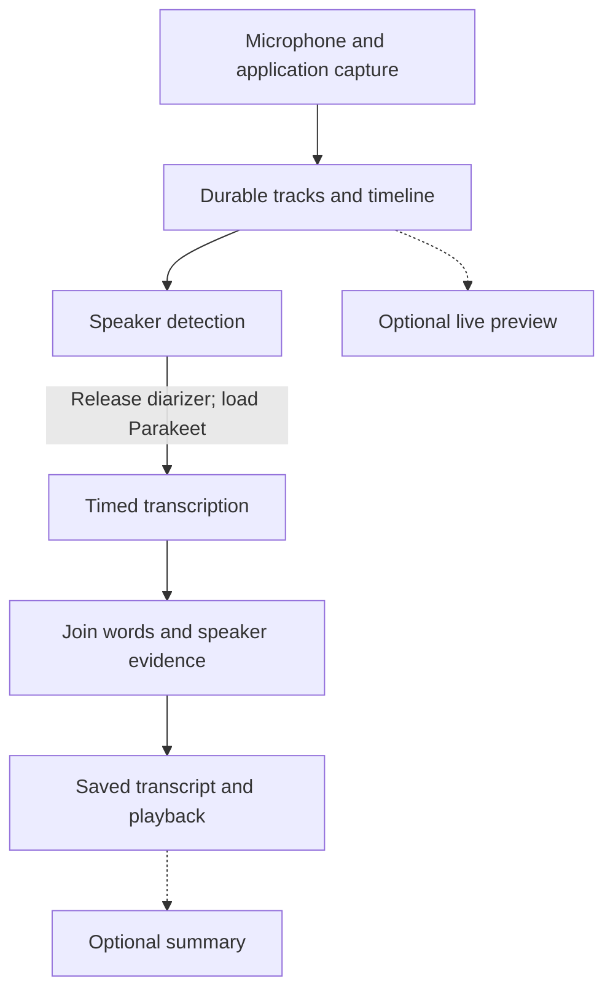

# Grain Meet — execution plan

**Status:** implementation started on `feat/grain-meet`; structured TDT evidence increment implemented. Step 0 model/worker feasibility and benchmarks remain incomplete. See [progress and validation](PROGRESS.md).
**Diarizer decision (2 November 2026, user, revised):** the diarizer is **Nemotron 3 Diarization** Q8_0, the model family FluidMeet and Glimpse use, so their tuning applies directly. It was backported from Glimpse's fork onto Grain's native fork as researched in [DIARIZER-RESEARCH.md](DIARIZER-RESEARCH.md) (option B): native pin `c8cf6b11dd5e67131b264025112293bda1bb8c86`, contract 6. Sortformer v2.1 is no longer used. Earlier mentions of Sortformer below describe the first implementation and its measurements.
**Prepared:** 1 November 2026.
**Reference:** FluidVoice’s FluidMeet workflow and implementation, adapted to Grain’s existing Rust/Tauri application and `transcribe.cpp 0.4` runtime.
**User-facing name (2 November 2026, user):** the UI calls the feature **Recall** for now; the name is not final. It is a display string only, defined once in the frontend's localized strings, so it can change without touching anything else. Internally the feature stays **Meet**: the `grain_meet` module, `meet_*` commands, `meet-*` events, `docs/Meet` and the `feat/grain-meet` branch.
**UI base (2 November 2026, user):** the UI is built on `feat/grain-meet` against the current interface, not on `ui/grain-2.0`.
**Primary constraint:** preserve the Handy backend boundary and keep memory use, new dependencies, and long-term maintenance small.

## 1. The decision

Build Grain Meet as a first-party Grain workspace for recording, reviewing, and transcribing meetings locally. Follow FluidVoice’s architecture: preserve the recording first, identify speakers in a dedicated pass, transcribe with Parakeet in a separate pass, then join the evidence into a speaker-attributed transcript. Optional live captions and summaries come after the reliable recording and final-transcript path.

**Use Parakeet TDT v3 plus the standalone Sortformer v2.1 diarizer already supported by Grain’s pinned native runtime for the first implementation.** Run the models sequentially in the existing isolated worker. Keep the backend contract independent of the particular diarizer so Nemotron 3 can replace Sortformer later without changing capture, storage, the transcript format, or the UI. Nemotron 3 uses the same native DIARIZE call and run extension, so that upgrade does not change the Grain worker bridge. [G2, N1, D1]

This gives us FluidMeet’s product architecture, with an explicit initial difference: FluidVoice uses Nemotron 3, which offers eight speaker slots; the initial Grain backend has four slots per analyzed track. The four-slot limit is not a promise to identify an unlimited succession of people. Grain must describe this limit honestly and preserve uncertain attribution. Exact Nemotron 3 parity is a separate upgrade milestone; [DIARIZER-RESEARCH.md](DIARIZER-RESEARCH.md) records the candidate port and its divergences. [F1, F2, N1, N4, N5]

The bundled English Multitalker model is an optional comparison candidate. It is not the selected implementation path: the user has chosen the separate-diarizer-plus-Parakeet approach used by FluidVoice. Do not introduce a second inference runtime to get the first release working.

### What the first usable release includes

- A **Meet** workspace with a meeting list and meeting detail view.
- Explicit **Online call** and **In-room meeting** capture modes.
- Online capture keeps microphone and selected application audio separate. Room capture keeps the microphone as its own track.
- Durable, recoverable audio; visible recording status, elapsed time, and per-source activity.
- A final local transcript with timestamps, anonymous speaker labels, uncertainty, and visible capture/processing gaps.
- Playback linked to transcript positions, speaker renaming, transcript search, retry processing, export, and deletion.
- The ability to retain a recording and process it later when a model is unavailable.
- A useful transcript even when speaker detection fails.

Live captions are skipped for now (user decision, 2 November 2026). Automatic speaker matching between meetings, automatic meeting detection, and AI summaries are subsequent milestones. Their absence does not prevent recording or a final transcript.

## 2. The verified starting point

Freeze the implementation baseline before coding. At inspection, Grain `main` is `1ae535976d2cf2deeabefd038f2ab2e038ff7ed9`; the extension-cleanup branch is `30a4e74d4b189b374b2664121de0def2e56e0b25`. The latter contains the inspected integration seams. Do not silently treat it as already merged or build against a different branch’s APIs. Recheck these refs at kickoff and branch from the agreed integration head. [G1]

The native manifest pins `Punit-Dethe/transcribe.cpp` at `eeffcc3887018015d04d20e61d3698a33d790f24`, version `0.4.0`, contract revision `5`, patch identity `grain-flow-tdt`. Verified on 2 November 2026: this revision is upstream tag v0.4.0 (`f1dcd15`) plus 5 Grain Flow commits, and Handy `main` uses the same crates.io 0.4.0 release. Upstream has since released 0.4.1; Grain stays on 0.4.0 with Handy. Keep this pin: Sortformer v2.1 needs no native change. [G2, D1]

| Verified code fact | Consequence for this plan |
| --- | --- |
| Grain already has a subprocess inference supervisor, cancellation epochs, recovery, and CPU fallback. | Extend its existing lifecycle; avoid another worker service or scheduler. |
| The worker currently stores an ASR `Session` and loads models through `.session()`. | Standalone diarization needs a role-aware load/dispatch bridge; exposing a model download alone is insufficient. |
| Native Rust already exports `DiarizeSession`, `DiarizeOptions`, and speaker segments. | Verified on Windows CPU and Vulkan with pinned Sortformer v2.1 (native Rust tests, 2 November 2026). No new model port is needed for the initial Sortformer backend. |
| Native Parakeet builds timed tokens, words, and segments. | Preserve structured output through the Grain adapter instead of reducing it to a string. |
| Grain’s bounded TDT adapter retains timed tokens internally but its public final rendering returns text. | Add a structured-result path in Grain-owned code, with exact-text regression checks for existing Flow. |
| The current Grain worker-query extension uses a 30-second call timeout. | Meeting tasks need operation- and duration-aware deadlines through the same supervisor. |
| The PCM wire format builds complete frames and accepts sections up to 1 GiB. | That limit is not a safe memory budget. Avoid sending an entire meeting through this path. |
| `PcmJournal` is temporary and deletes itself with its owner. | Reuse its range-reading principles, but create explicitly durable meeting storage. |
| Native standalone diarization takes one complete PCM slice per run. | A streaming model architecture does not establish a public incremental API or bounded end-to-end memory. Glimpse documents about 1.5 GB peak per hour for whole-clip diarization with the same native API. Measure Sortformer's actual growth in Step 0. |

These conclusions come from the pinned source, not from successful runtime measurements. [G3–G6, N1–N3]

## 3. What we adopt from FluidVoice

The reference is `altic-dev/FluidVoice` at `dd3766444971547650e677289208487b3c92e330`. Its production meeting runtime explicitly describes the loaded-model sequence as diarization, release, Parakeet, release. Its recording and optional live-caption paths are separate from final processing. [F1–F5]

| FluidVoice pattern | Grain Meet implementation decision |
| --- | --- |
| Separate microphone and application tracks. | Preserve source identity through recording, analysis, playback, and export. Never mix these tracks before speaker attribution. |
| PCM-first recording in durable chunks. | Store recoverable chunks and a session manifest; process from saved audio. |
| Fresh diarizer state per track, continuous analysis within a track. | Scope anonymous speakers to a track and analysis run. Keep continuity across storage chunks; reset only at a declared analysis boundary. |
| Dedicated diarization, followed by timed Parakeet ASR. | Same phase ordering through Grain’s existing runtime and worker. |
| Join speaker activity to timed words. | Use deterministic interval evidence, preserve overlap and uncertainty, and make the policy testable. |
| Explicit model residency ownership. | Use Grain’s existing inference lease with meeting-aware ownership and cleanup. |
| Live captions are a separate, optional preview. | Keep previews provisional and disposable; the final transcript comes from the durable recording. |
| Saved final evidence and later summarization. | Publish a transcript before any summary; optional summaries reference that transcript revision. |

Two deliberate improvements belong in the foundation. First, a diarization failure must not suppress otherwise transcribable audio: the inspected FluidVoice backend skips ASR for epochs that failed its diarization phase. Second, plan and measure total inference memory rather than assuming chunked recording solves it: FluidVoice’s materializer itself documents a substantial in-memory PCM bound. These are improvements to reliability and resource use, not reasons to redesign its whole workflow. [F2, F6]

Treat FluidVoice as a behavioral and architectural reference. Implement the Grain modules in Rust/TypeScript; do not copy its Swift subsystem wholesale. Record source attribution in the design document. Its repository contains a GPLv3 license; any proposed source reuse needs a separate compatibility review before inclusion. [F8]

## 4. Architecture and ownership

The diagram shows processing dependencies. Recording completes independently of final inference, and each heavy model phase releases its resources before the next begins.

### Code placement

Use a Grain-owned `src-tauri/src/grain_meet/` module, split by responsibility only as implementation requires:

| Area | Responsibility |
| --- | --- |
| `mod.rs`, `commands.rs` | On-demand session coordination, typed Tauri commands and events. |
| `capture/` | Small platform adapters producing the same timestamped track blocks. |
| `storage.rs`, `timeline.rs` | Chunk persistence, recovery, manifest validation, and time mapping. |
| `processing.rs`, `inference.rs` | Frozen processing requests, phase sequencing, existing-worker adapter. |
| `transcript.rs` | Pure evidence assembly, speaker assignment, transcript revisions and user edits. |
| `export.rs` | Transcript and audio export using the canonical saved result. |

Keep frontend views and state under a Grain-owned feature directory such as `src/features/meet/`, integrated through the existing navigation. These paths are proposed, not files that already exist. Reuse established components, settings, localization, model downloads, and command generation.

Use existing `grain_engine.rs`, `grain_transcription.rs`, and `grain_transcription_manager.rs` for the narrow runtime bridge and ownership changes. Extract a shared primitive into an existing Grain crate only when both current dictation and Meet actually need it. Do not begin with a new crate, plugin platform, event bus, daemon, or general job framework.

### Handy boundary

All meeting policy belongs in Grain-owned files. Changes under `src-tauri/src/handy/` must be small, marked `[GRAIN]` hooks delegating to those files. Expected hook sites are the existing supervisor/worker transport and any necessary capture-ownership seam; the feasibility milestone must identify the exact diff before implementation expands.

Every integration PR records which Handy-derived files changed, why each hook is necessary, and its divergence-budget effect. Use the existing ratchet and upstream policy checks. Do not add a second machinery layer to maintain this feature. Generic runtime capability improvements should be suitable for upstreaming; meeting UI and policy stay in Grain. [G1, G7]

## 5. Recording and the authoritative timeline

### Capture contract

Each delivered block carries session ID, track ID, capture generation, source identity, sample format, sample rate, channels, source frame position, monotonic capture time, and discontinuity information. Generation checks reject late callbacks from a stopped or replaced source.

The real-time callback only delivers into a bounded queue. Disk writes, hashing, inference, frontend events, and resampling do not block that callback. Record queue overflow as a gap with a reason; never make a missing interval look like valid silence. Stop safely on persistent writer failure and preserve already committed audio.

Use one coordinator for the meeting’s actual capture resources. A dual-track meeting is not two independently started dictation sessions. Both tracks share a meeting clock while retaining their own device timestamps and frame counts.

### Storage format

Use one durable session directory with a small versioned manifest, per-track PCM chunks, processing-attempt artifacts, and transcript revisions. Start with approximately 60-second Float32 WAV chunks, rotating earlier at format changes or discontinuities. WAV reuses the project’s existing audio-file tooling; the manifest provides the richer timeline. Keep native capture rate/channels where needed, with 48 kHz as a common operating format rather than a hard assumption.

Write active files under partial names. Seal a chunk, flush and synchronize it, then publish its metadata atomically. Define a tested checkpoint policy for the active chunk. Recovery must retain committed chunks and salvage a valid partial tail when possible; it must report the recovered extent. Process-crash tests and power-loss guarantees must be described separately.

Do not reuse the temporary journal’s delete-on-drop behavior for recordings. Reuse bounded range-reading code where practical without changing Flow’s current lifetime semantics.

The manifest is authoritative for a session. Avoid modifying Handy’s dictation-history schema. A lightweight meeting index can be reconstructed from manifests; keep initial listing lazy and do not read audio or full transcripts to render the list. No new database service is needed.

### Timeline rules

- Use monotonic time and integer frame counts for alignment. Wall-clock time labels the meeting but does not position audio.
- Map each captured range to a meeting interval. Track resampler phase/delay and actual output sample counts.
- Preserve continuous recorded silence. VAD may choose an ASR boundary; it must not silently shorten the recording timeline.
- A missing interval, pause, device restart, and actual silence are distinct facts.
- Storage chunk rotation does not reset speaker state or decoder state.
- If discontinuous spans are joined for diarization, record each mapping and any synthetic separator. Separator audio is excluded from transcript coverage and playback time.
- A change to a genuinely different source starts a new identity scope. Reusing a numeric speaker slot does not establish the same person.
- Keep the original recording intact if analysis or resampling fails.

### Platform sequence

Start with imported fixtures and microphone recording to exercise the shared pipeline, then implement Windows online capture first, consistent with the project’s current Windows release work. This is a proposed execution order, not a claim that other platforms are finished.

| Platform | Capture path and acceptance requirement |
| --- | --- |
| Windows | WASAPI application/process loopback plus microphone. Probe actual OS capability. Test process-tree behavior for browser calls; application capture may include more than one tab. Whole-device loopback is a separately labeled, explicit choice where supported. |
| macOS | ScreenCaptureKit application audio plus microphone through an appropriate native adapter. Verify permission flows, supported OS versions, self-audio exclusion, and clock mapping in the actual packaged app. |
| Linux | Share storage/inference/UI contracts. Validate microphone capture first; research and test PipeWire/PulseAudio source support before enabling online capture. Unsupported modes remain visibly unavailable. |

Never silently switch a failed application source to microphone-only capture or to all desktop audio. Source selection must describe the actual scope. OS capability detection is more reliable than promising one minimum version from documentation alone. [P1, P2]

*Status (2 November 2026, user decision):* Windows whole-output-device loopback shipped first as the "System audio" source, chosen per output device and independent of dictation's microphone. Per-application capture is still to do. See `PROGRESS.md`, Increment 7.

### Echo and duplication

Headphones are the initial controlled acceptance case. Speakerphone recording requires separate tests for remote audio leaking into the local microphone. Keep the two raw tracks and timing evidence. Do not delete repeated phrases merely because their text matches: both participants may legitimately say the same words.

Evaluate available platform processing before adding an AEC dependency. Any echo suppression must be delay-aware and tested with double talk. Unsupported acoustic setups receive an honest limitation; they must not silently produce a transcript claimed to have reliable speaker separation. Do not label every microphone word “You” in room mode.

## 6. Inference without another engine

### One frozen processing attempt

Before processing, snapshot session revision, ordered audio spans, model IDs and hashes, runtime revision, quantization, device policy, language intent, and algorithm settings. Settings changed during a run apply to the next attempt. Every result and event carries session ID and attempt ID so a canceled or superseded run cannot overwrite the current transcript.

The first backend executes this sequence:

1. Validate committed audio and available model artifacts; acquire exclusive inference ownership.
2. Prepare reusable 16 kHz mono analysis files and exact source-to-analysis maps, processing one track at a time.
3. Load Sortformer using `DiarizeSession` at the offline `VeryHighLatency` preset; analyze tracks serially, with independent speaker state for each identity scope. Persist speaker evidence.
4. Release the diarizer and drain native resources before proceeding.
5. Load the existing Parakeet v3 model; transcribe each track with structured timing output and bounded audio windows where validated.
6. Release Parakeet; join the saved evidence and atomically publish a transcript revision.
7. Release ownership and temporary resources. Restore normal readiness according to current settings, without resurrecting a model the user has since deselected.

### The worker bridge is real work

The current worker extension assumes an ASR session exists. Implement a narrow role-aware bridge, not just new enum values. It must handle:

- Creating the right native session for ASR or DIARIZE and rejecting unsupported roles explicitly.
- A single resident model role at a time, including during failure, cancellation, and GPU recovery.
- Correct loaded-model metadata and reload specifications after switching roles.
- Existing cancellation epochs and worker termination, including cancellation during model loading.
- Operation-appropriate deadlines based on the submitted duration and backend, rather than the present 30-second query deadline.
- Correct retry classification. A bad file or unsupported model is not a GPU crash; canceled work must never be retried.
- Recovery that reloads the requested role, model, and configuration, rather than a stale dictation model.

Long-file tasks should pass a validated reference to worker-readable analysis audio, not an entire meeting copied through the PCM protocol. Keep this capability private to the backend: the frontend supplies a meeting ID, not an arbitrary file path. Validate file bounds, format, ownership, and session-relative location before the worker reads it. Start with one worker-local buffer per analyzed track; memory mapping is an optimization only if its behavior is measured. A file reference removes transport copies but does not remove native mel or prediction allocations.

### Structured Parakeet output

The preferred reuse is the existing Grain-owned bounded TDT adapter and its reviewed native buffered contract. Extend it with a structured result path while preserving the existing text path. Retain token IDs, token timing/duration, word membership, and source-span provenance before dictionary replacement, filler cleanup, or AI rewriting.

Word construction at a window boundary requires explicit validation: a word may span token batches. Reuse native result/tokenizer semantics and retain unresolved boundary material until the next window supplies enough evidence. Do not independently normalize or concatenate text windows and then guess where their words occurred.

Acceptance requires final text to match the existing reviewed decoding policy, with no duplicated or dropped boundary words and stable timing across different input chunk sizes. If the current adapter cannot supply that contract without a larger native change, document the smallest alternative before coding around it. A separately measured native offline path can serve as an oracle, not an excuse for unbounded production buffers.

Native tokens can have zero duration. Preserve their text and represent point/unknown timing honestly; do not discard words simply because an interval has zero width. When reliable word timing is absent, retain utterance-level or untimed text with provenance. Do not fabricate evenly spaced word timestamps. [N2, N3, G6]

### Long-meeting memory gate

At 16 kHz mono Float32, one hour is **230.4 MB per track** before mel features, model state, transport copies, results, or GPU memory. Two tracks are 460.8 MB if retained together. At 48 kHz with stereo application audio plus mono microphone, raw capture is approximately **2.07 GB per hour**. These are arithmetic storage/input sizes, not measured peak RAM.

The first feasibility milestone must measure the whole process tree for 10-, 60-, and 120-minute recordings, including input preparation and model transitions. Process tracks serially and avoid retaining both full tracks in RAM. Capture must remain bounded with duration; transcript and on-disk data naturally grow.

The native diarization entry point currently accepts a full PCM slice and internally performs chunked inference. Measure its actual memory growth before promising a duration limit. If the low-memory target fails, choose explicitly between a smaller advertised processing duration and a focused native incremental/file-processing improvement. Do not reset the diarizer every few minutes and assume speaker IDs remain consistent. Do not create an embedding-and-clustering subsystem merely to disguise that reset.

Suggested initial engineering targets, to validate in the feasibility report, are: a 60-minute dual-track meeting on a representative 8 GiB machine; recording overhead that does not grow with duration; at most 200 MiB incremental host RAM for recording without captions; and at most 2 GiB incremental total process-tree RAM during final processing. Measure VRAM separately on discrete GPUs and avoid double-counting unified memory. These are proposed gates, not current performance claims. If a target fails, record the result and adjust the supported envelope explicitly rather than silently relaxing the test.

**Measured and decided (2 November 2026).** Sortformer peaked at about 1.2 GiB of worker memory per hour of one track; Nemotron 3 peaks at 1.3 GiB at 60 minutes and 1.85 GiB at 90 minutes (see [PROGRESS.md](PROGRESS.md), Increment 8). The user chose FluidMeet's approach, tuned later: diarize each whole track in one run and process tracks one at a time, with **a 90-minute cap per track** (`grain_engine::MAX_ANALYSIS_SAMPLES`, about 1.8 GiB peak). A longer track is kept, and its processing is refused with the limit stated. No further duration experiments are planned for the first release.

### FluidMeet tuning adopted for the first release

Read from FluidVoice `dd37664`. FluidMeet diarizes and transcribes after recording; its optional live captions run no diarization. Use these values unchanged and tune later. "Grain status" says where each value applies.

| Value | FluidMeet source | Grain status |
| --- | --- | --- |
| Diarize each track's whole audio in one run, one speaker state per track; never piece-wise | `MeetingParakeetNemotronBackend.runAttempt`, phase A | Worker bridge (done) |
| Retained-PCM ceiling: 256 Mi float32 samples (1 GiB; about 140 min across two 16 kHz tracks) | `MeetingEpochAudioMaterializer.conservativeSampleLimit` | **Grain deviation (user, 2 November 2026):** 90 minutes per track instead, from the measured memory |
| Join a track's capture epochs with 0.5 s of silence before diarizing; map segments back per epoch | `epochJoinSilenceSeconds` | Step 3 |
| Diarizer failure on an epoch: FluidMeet also skips its ASR | phase B | **Grain deviation, already in the plan:** still transcribe and mark speakers unavailable |
| Pad ASR input shorter than 1 s with silence to 1 s; keep the original length for timing | `asrInput` | Step 3 |
| Storage chunk: 60 s (minimum 60 s); rotate early on a clock boundary or a gap over 0.5 s | `MeetingCaptureConfiguration.defaultChunkDuration`, `MeetingAudioChunkWriter` | Steps 1 and 4 |
| Word assignment noise floor: min(80 ms, 20% of the word's duration) | `nemotronCadenceMaximumFloorSeconds`, `boundaryNoiseThresholdSeconds` | Step 3 |
| Dominance: leader at least 50% coverage, runner-up at most 20%, leader at least 2x runner-up; otherwise ambiguous. A sole candidate above the floor assigns. Same-speaker intervals are unioned before measuring. | `SpeakerDominancePolicy`, `coverageSeconds` | Step 3 |
| Boundary recovery: 80 ms hop, words up to 1.2 s; recover one adjacent boundary word, never a run of text in silence | `MeetingWordBoundaryRecovery` | Step 3 |
| A secondary speaker needs at least 10 words and 5 s across its epochs to get its own label | `MeetingTranscriptAssembler.minimumSpeakerWords/Seconds` | Step 3 |

These are FluidMeet's values for Nemotron 3 (
emotronCadenceMaximumFloorSeconds and the rest), the diarizer Grain now uses, so they apply unchanged.

## 7. Transcript and speaker correctness

Use a compact canonical result with these concepts:

| Record | Required meaning |
| --- | --- |
| Meeting/session | Stable ID, title, creation time, capture state, recording revision. |
| Track and span | Source identity, sample facts, meeting-time mapping, discontinuities and gaps. |
| Processing attempt | Frozen inputs/configuration, stage status, errors, runtime/model provenance. |
| Speaker activity | Track/scope-local label, interval, original model evidence when available. |
| Text unit | Text/tokens, reliable timing precision, source spans, attribution and uncertainty. |
| Transcript revision | Immutable published result and completeness status. |
| User edits | Speaker aliases, corrections and merges associated with a transcript revision. |

The source track and inferred speaker are separate fields. “Application audio” is evidence about origin, not the identity of a particular remote person. Speaker IDs are namespaced by track and analysis scope. Speaker 1 on two tracks does not automatically mean the same person.

### Assignment policy

Begin with FluidVoice’s conservative interval-overlap approach as a test baseline: union same-speaker activity intervals, ignore tiny boundary slivers relative to the word, assign a sole credible candidate, and require a clear lead when multiple candidates overlap. Its current dominance policy uses at least 50% leader coverage, at most 20% runner-up coverage, and a 2:1 lead; these are starting parameters for evaluation, not universal constants. Model cadence and timing uncertainty must inform the policy. [F2]

Store the evidence and assignment status so the policy can improve without repeating capture. Preserve `unassigned` and `ambiguous` results. Point-timed words and text without timing have distinct handling; never divide by a zero-duration interval. A diarizer detecting overlapping voices does not mean ordinary Parakeet has recovered every overlapping word.

Build readable turns after attribution, respecting source, speaker, gaps, and overlapping activity. Do not force overlapping speech into a fictional sequential conversation. Keep raw inference evidence separate from display edits and optional rewritten text.

### Completeness and failure

Account for every recorded span as processed, intentionally excluded with a reason, missing, or failed. A fully processed silent span can legitimately contain no words. A complete-processing status is not a guarantee of perfect recognition.

If diarization fails, continue ASR for the affected audio and publish source-labeled text with speaker attribution unavailable. If ASR fails on one span or track, retain the rest and show the missing range. If final publication fails, keep the attempt artifacts and the previous published transcript.

Reprocessing creates a new revision. Keep user corrections separately and preserve the old revision; do not attach old word edits to new words by list index. Speaker aliases may need user reconciliation when the model changes its partition.

## 8. Lifecycle, recovery, and resource rules

Use a small explicit lifecycle: preparing, recording, finalizing recording, recorded, processing, ready/partial, or failed. Cancellation and recovery are transitions with saved outcomes. Separate capture state from processing-attempt state; canceling transcription does not delete a recording.

Default to one recording and one active inference attempt. Recording, dictation, and meeting processing must obey the existing capture/inference ownership rules. Initially, dictation is unavailable while a meeting owns the microphone or shared model; display the reason. Starting a new recording must never silently interrupt or reassign an active resource owner. The user can cancel processing and retain its recording before starting another meeting.

Persist completed stage outputs. A restart can reuse a completed diarization result if the exact input/configuration matches. An interrupted stateful diarization or buffered ASR run must restart at its valid scope boundary; saving transcript windows does not serialize native decoder or speaker-cache state. Do not promise mid-window inference resume without a real state-restoration contract.

Before returning to idle, close capture handles, drain writers, terminate or unload the model worker as appropriate, release leases, detach listeners, and remove disposable analysis files. Cancellation must wait for ownership cleanup before admitting replacement work. Stale completion, progress, and cleanup messages must not affect a new attempt.

If the app closes during recording, the next launch offers the recovered session for review and processing. It does not silently restart microphone capture. Deletion cancels owned work before removing the session’s audio, transcripts, and temporary artifacts. Reuse the project’s existing local-data and logging conventions; diagnostics should not contain meeting text or audio by default.

## 9. User experience and optional stages

**Before recording:** choose Online call or In-room; choose the actual source and microphone; show source activity, permissions, free space, model availability, and the difference between recording readiness and transcription readiness. If models are missing, offer download or record now/process later.

**During recording:** keep Record/Stop, elapsed time, source meters, and a persistent recording indicator visible. Show a source loss or disk problem immediately. Closing a view must not ambiguously stop or conceal recording. Native permissions and recording indication remain explicit.

**After Stop:** first make the saved recording available, then show the actual processing stage. Progress uses completed audio/stage work; do not invent a precise completion time before measurements support it. Cancel processing preserves the recording.

**Meeting detail:** transcript and playback share one timeline. Show speaker labels, rename controls, uncertainty and gaps. Offer retry, search, export and delete. Export canonical JSON and readable text first; add SRT/VTT when their timing and overlap policy is tested. Fetch transcript/audio pages on demand rather than loading hours of data into the webview.

### Live preview milestone

**Skipped (user decision, 2 November 2026):** no live preview or live transcription is built for now, even as a later step of this plan. The rest of this subsection is kept only as background.

Only add captions after final processing passes the release gates. Feed a bounded tee after capture delivery; a slow preview may drop preview work but never block the authoritative recording. Show source-based labels and provisional text. Fully release preview inference before final processing.

Reuse a validated existing streaming or bounded-batch capability. Never alternate two tracks through one persistent decoder state. On low-memory machines, leave previews off. If two independent contexts cannot fit the measured budget or the current worker contract, ship the recorded workflow first and document the capability gap. FluidVoice’s separate caption engines are an example of this isolation, not a mandate to add its Swift runtime. [F5]

### Summary milestone

Generate a summary only after a transcript revision is saved. Reuse Grain’s existing AI/provider infrastructure if it supports the needed bounded text task; do not introduce another model host. Long transcripts require chunking with source references, and factual claims should link back to transcript ranges.

Local recording and ASR remain usable without summarization. A remote summary is an explicit user-selected action governed by existing provider controls; never automatically upload a recording. Meeting speech is task data, not authority to invoke tools or send messages. Canceling or failing a summary leaves the transcript intact. An existing summary becomes stale when its source transcript revision changes.

## 10. Execution milestones and mergeable increments

Implement the dependencies in order. Documentation and feasibility decisions should accompany the relevant code; avoid a long-lived all-or-nothing feature branch.

| Step | Deliverable | Exit criterion |
| --- | --- | --- |
| **0. Feasibility and baseline** | Freeze refs, inspect actual target packaging, exercise Sortformer and timed v3 through the current runtime, measure memory, capture a minimal role-bridge design. | A reproducible evidence report identifies supported backends, CPU/Vulkan parity, timing quality, cancellation behavior, duration/RAM envelope, and exact required hooks. No unsupported assumptions remain on the critical path. |
| **1. Canonical contracts and storage** | Grain-owned types, session manifest, durable chunk writer, time maps, recovery and saved-audio fixtures. | Crash/partial-file recovery works; every range is accounted for; no model dependency is needed to inspect saved sessions. |
| **2. Worker role bridge** | DIARIZE loading, structured ASR calls, file-backed input, deadlines and meeting leases using the existing supervisor. | ASR → diarization → ASR, cancellation, wrong-role errors and CPU fallback pass through the real worker with one resident role. |
| **3. Saved-audio final pipeline** | Two-pass processing, bounded Parakeet results, attribution, revision publication, transcript-only degradation. | Reference fixtures produce timed transcripts; no boundary-word loss; speaker continuity survives storage chunking; failures remain visible. |
| **4. Microphone capture** | Real recording to the same store, source lifecycle and recovery. | A full-length room recording survives stop, restart, source loss and low-disk tests. |
| **5. Windows online capture** | Selected-application audio plus microphone, synchronized maps and source selection. | Two-source fixtures, browser calls, device changes, source exits and echo cases pass on supported Windows builds. |
| **6. Meet workspace** | List, recorder, detail, playback, rename/search/export/retry/delete; generated Tauri bindings. | Real-app journeys pass and the user reviews the concrete UI. No browser-only replica is used for acceptance. |
| **7. Hardening and first release** | Resource audit, performance envelope, fault tests, packaging/model-download checks and documentation. | All mandatory gates below pass. Unsupported platforms/modes remain capability-gated. |
| **8. Platform expansion** | macOS online capture, then validated Linux modes through the same interfaces. | The same core acceptance suite passes per enabled platform. |
| **9. Optional experience parity** | Summaries. *(Live captions skipped by user decision, 2 November 2026.)* | Each meets its own memory, isolation, cleanup and correctness gates; neither weakens recording. |
| **10. Model improvements** | Controlled Parakeet Ultra and Nemotron 3 comparisons. | Promote only on demonstrated value, compatibility and acceptable maintenance cost. |

Steps 1–3 form the first end-to-end technical milestone: **saved audio to a reviewable speaker-attributed transcript**. Steps 4–7 produce the first usable Grain Meet release. Product UI sketches can inform the contracts early, but visual polish should not precede proof that the recording and inference path works.

At kickoff, follow current branch policy. The inspected repository requires UI 2.0 overhaul work on `ui/grain-2.0`; do not silently mix an overhaul with the cleanup branch or push directly to `main`. Keep the Meet backend work isolated and resolve the actual UI integration base before landing its view changes. Preserve unrelated work. [G1]

## 11. Acceptance gates

### Correctness and lifecycle

| Test family | Required evidence |
| --- | --- |
| Track/time mapping | Known impulses and speech markers align after resampling, drift, gaps, format changes and source restarts. Synthetic mapping tests stay within one analysis sample; real-device drift is measured separately. |
| Word boundaries | No duplicated/dropped words across storage or ASR boundaries, including repeated phrases, punctuation, short interjections, silence and final tails. Chunk partitioning does not change the reviewed final text policy. |
| Speaker identity | Same-track continuity; no cross-track slot collisions; ambiguity retained; a fixture above the speaker limit is not presented as reliable full separation. |
| Failure isolation | Diarizer failure still yields ASR; ASR failure preserves other spans; model/download failure preserves audio. |
| Ownership | Dictation, model loads, preview and final processing cannot race. Cancellation at every phase releases ownership; stale events and cleanup cannot affect a new attempt. |
| Recovery | Kill app/worker while recording, sealing, loading, diarizing, transcribing and publishing. Recover committed audio; publish no half-written transcript. |
| Platform capture | Permission denial/revocation, Bluetooth changes, source exit, suspend/resume, clock discontinuity and queue saturation produce correct state and visible gaps. |
| Export/editing | Playback positions, speaker aliases, uncertainty and completeness survive export; reruns preserve original evidence and user edits separately. |

### Quality and performance

Use a small, licensed/reproducible development set and a held-out acceptance set. Include online calls with separate local/remote tracks, in-room speech, overlap, long silence, noisy microphones, speakerphone leakage, supported non-English languages, four speakers, and a five-plus-speaker limitation case. Add 10-, 60-, and 120-minute resource tests. Repeated audio is useful for memory stress, not evidence of speaker-recognition quality.

Record model/runtime hashes, quantization, backend, hardware, normalization, diarization collar and overlap-scoring policy. Measure WER, diarization error and speaker-attributed transcription error separately; also count speaker swaps, duplicate words, missing spans and unassigned words. Do not compare WER, DER and cpWER as though they were the same metric.

Measure capture CPU, queue occupancy, disk throughput, processing real-time factor, cold/warm model load time, time to release resources, peak host/process-tree RAM and GPU memory. Use at least a representative low-memory CPU configuration and a supported accelerated configuration. Define the supported envelope from these measurements before exposing a duration/performance promise.

### Existing Grain checks

Run the affected Rust tests, frontend unit tests, lint/type checks, production builds, generated-binding checks and native contract checks appropriate to each change. Existing scripts include `bun run test:unit`, `bun run lint`, `bun run build`, and `bun run format:check`; use repository-prescribed Rust/native runners for the target platform. At UI milestones, exercise the real Tauri application and provide its actual run command, currently `bun run dev:asr`, for user visual review.

Use existing harness infrastructure where it covers the new journey; add narrowly scoped fixtures or scenarios, not another testing framework. Run the existing divergence/policy checks and inspect the actual changed-file diff. A budget update must explain a deliberate hook, not hide feature code under Handy. Record completed validation and untested hardware explicitly.

## 12. Improvements after the baseline

| Candidate | Why consider it | Promotion rule |
| --- | --- | --- |
| **Nemotron 3 diarization** | Exact model-family parity with FluidVoice, eight slots, and AMI DER 9.23% against Sortformer's 15.99% through the same pipeline. | Preferred route: backport the Glimpse slice onto the 0.4.0 fork (see [DIARIZER-RESEARCH.md](DIARIZER-RESEARCH.md) for scope, ABI renumbering and divergences), or adopt upstream once Handy ships a release that contains it. Verify CPU and shipped GPU backends, cancellation, long-form memory, artifact schema and ABI packaging. Benchmark the same saved meetings against Sortformer. |
| **Parakeet Ultra** | A compatible-family ASR candidate that may improve meeting recognition. | Treat as a final-ASR experiment. Verify actual model capabilities and timing/long-form behavior; do not silently add it to the Flow whitelist or assume native buffered-contract parity. Promote only after matched evaluation. |
| **Cross-scope speaker matching** | Reconnect a person after a genuine reset. | Add only if observed continuity failures justify an embedding dependency and its memory/lifecycle cost. Keep manual aliases first. |
| **Concurrent model execution** | Potentially lower completion time on large machines. | Consider only after sequential profiling shows a user-visible benefit within the RAM budget. It is not required for the first workflow. |
| **Multitalker ASR** | An alternative for difficult English overlapping speech. | Optional research track with its own language/capability limits; do not replace the selected paired backend without comparative evidence. |

At inspection, native Nemotron 3 PR #175 is open, unmerged and reports merge conflicts. Its existence is not a working integration in Grain’s pinned runtime. [N4] Its documentation says it is pending tolerance review. The Glimpse fork's independent port is shipped, published with AMI DER 9.23%, and ran on this Windows machine on CPU and Vulkan. It is the preferred source for the later upgrade. [N6, N7, D1]

Do not start with a FluidAudio/Core ML fork, a NeMo Python sidecar, a second C++ runtime, or automatic transcription/diarization model switching. Revisit an extra runtime only if a measured product requirement cannot reasonably be met by the existing one.

## 13. First implementation task

The next coding task should be **Step 0: a saved-audio feasibility slice**, followed by its evidence report. It should answer six concrete questions before UI work expands:

1. Can the pinned Sortformer model run through a small role-aware extension of the real Grain worker? (It already passes the native Rust tests at the current pin on Windows CPU and Vulkan.)
2. Can Grain preserve Parakeet v3 word/token timing across its existing bounded decoding path without changing dictation text?
3. What is peak memory for one track at 10, 60 and 120 minutes, including materialization and native features?
4. Do cancellation, device fallback and model-role transitions release resources correctly?
5. Does conservative time-based speaker assignment produce useful results on representative saved meetings?
6. What exact native/Handy hooks and supported duration limits are necessary?

Deliver the smallest working slice, the fixture/configuration manifest, measurements, and a precise change inventory. Update this plan with evidence before proceeding. No model execution, capture testing, or application changes were performed while preparing this document.

## Source register

All code links below identify the inspected revision. Repository state and available models must be rechecked at implementation kickoff.

- **G1 — Grain guidance and baseline:** [AGENTS.md](https://github.com/Punit-Dethe/Grain/blob/30a4e74d4b189b374b2664121de0def2e56e0b25/AGENTS.md), [cleanup revision](https://github.com/Punit-Dethe/Grain/commit/30a4e74d4b189b374b2664121de0def2e56e0b25), [main revision](https://github.com/Punit-Dethe/Grain/commit/1ae535976d2cf2deeabefd038f2ab2e038ff7ed9).
- **G2 — Native pin:** [transcribe-fork.json](https://github.com/Punit-Dethe/Grain/blob/30a4e74d4b189b374b2664121de0def2e56e0b25/native/transcribe-fork.json).
- **G3 — Existing worker:** [worker.rs](https://github.com/Punit-Dethe/Grain/blob/30a4e74d4b189b374b2664121de0def2e56e0b25/src-tauri/src/handy/engine_supervisor/worker.rs), [supervisor.rs](https://github.com/Punit-Dethe/Grain/blob/30a4e74d4b189b374b2664121de0def2e56e0b25/src-tauri/src/handy/engine_supervisor/supervisor.rs), [protocol.rs](https://github.com/Punit-Dethe/Grain/blob/30a4e74d4b189b374b2664121de0def2e56e0b25/src-tauri/src/handy/engine_supervisor/protocol.rs).
- **G4 — Grain inference ownership:** [grain_transcription.rs](https://github.com/Punit-Dethe/Grain/blob/30a4e74d4b189b374b2664121de0def2e56e0b25/src-tauri/src/grain_transcription.rs), [grain_transcription_manager.rs](https://github.com/Punit-Dethe/Grain/blob/30a4e74d4b189b374b2664121de0def2e56e0b25/src-tauri/src/grain_transcription_manager.rs), [grain_engine.rs](https://github.com/Punit-Dethe/Grain/blob/30a4e74d4b189b374b2664121de0def2e56e0b25/src-tauri/src/grain_engine.rs).
- **G5 — Existing audio primitives:** [grain_audio_journal.rs](https://github.com/Punit-Dethe/Grain/blob/30a4e74d4b189b374b2664121de0def2e56e0b25/src-tauri/src/grain_audio_journal.rs), [grain_audio_manager.rs](https://github.com/Punit-Dethe/Grain/blob/30a4e74d4b189b374b2664121de0def2e56e0b25/src-tauri/src/grain_audio_manager.rs).
- **G6 — Bounded TDT adapter:** [tdt_flow.rs](https://github.com/Punit-Dethe/Grain/blob/30a4e74d4b189b374b2664121de0def2e56e0b25/src-tauri/src/tdt_flow.rs).
- **G7 — Upstream boundary:** [UPSTREAM-DIVERGENCE.md](https://github.com/Punit-Dethe/Grain/blob/30a4e74d4b189b374b2664121de0def2e56e0b25/Upstream/UPSTREAM-DIVERGENCE.md), [ratchet.py](https://github.com/Punit-Dethe/Grain/blob/30a4e74d4b189b374b2664121de0def2e56e0b25/Upstream/ratchet.py).
- **F1 — FluidVoice production model lifecycle:** [MeetingProductionParakeetNemotronRuntime.swift](https://github.com/altic-dev/FluidVoice/blob/dd3766444971547650e677289208487b3c92e330/Sources/Fluid/Services/Meeting/Backend/MeetingProductionParakeetNemotronRuntime.swift).
- **F2 — FluidVoice paired backend and assignment:** [MeetingParakeetNemotronBackend.swift](https://github.com/altic-dev/FluidVoice/blob/dd3766444971547650e677289208487b3c92e330/Sources/Fluid/Services/Meeting/Backend/MeetingParakeetNemotronBackend.swift).
- **F3 — FluidVoice capture storage:** [MeetingAudioChunkWriter.swift](https://github.com/altic-dev/FluidVoice/blob/dd3766444971547650e677289208487b3c92e330/Sources/Fluid/Services/Meeting/MeetingAudioChunkWriter.swift), [MeetingPCMStoragePolicy.swift](https://github.com/altic-dev/FluidVoice/blob/dd3766444971547650e677289208487b3c92e330/Sources/Fluid/Services/Meeting/MeetingPCMStoragePolicy.swift).
- **F4 — FluidVoice model ownership:** [MeetingModelResidencyCoordinator.swift](https://github.com/altic-dev/FluidVoice/blob/dd3766444971547650e677289208487b3c92e330/Sources/Fluid/Services/Meeting/MeetingModelResidencyCoordinator.swift).
- **F5 — FluidVoice optional preview:** [MeetingLiveTranscriptionCoordinator.swift](https://github.com/altic-dev/FluidVoice/blob/dd3766444971547650e677289208487b3c92e330/Sources/Fluid/Services/Meeting/LiveTranscription/MeetingLiveTranscriptionCoordinator.swift).
- **F6 — FluidVoice materialization limits:** [MeetingEpochAudioMaterializer.swift](https://github.com/altic-dev/FluidVoice/blob/dd3766444971547650e677289208487b3c92e330/Sources/Fluid/Services/Meeting/Backend/MeetingEpochAudioMaterializer.swift).
- **F7 — Official product explanation:** [FluidMeet announcement](https://fluidvoice.com/fluid/blog/fluidmeet).
- **F8 — FluidVoice license:** [LICENSE](https://github.com/altic-dev/FluidVoice/blob/dd3766444971547650e677289208487b3c92e330/LICENSE).
- **N1 — Pinned native diarization API and model:** [Rust DiarizeSession](https://github.com/Punit-Dethe/transcribe.cpp/blob/eeffcc3887018015d04d20e61d3698a33d790f24/bindings/rust/transcribe-cpp/src/diarize.rs), [Sortformer model documentation](https://github.com/Punit-Dethe/transcribe.cpp/blob/eeffcc3887018015d04d20e61d3698a33d790f24/docs/models/diar_streaming_sortformer_4spk-v2.1.md).
- **N2 — Native structured result:** [result.rs](https://github.com/Punit-Dethe/transcribe.cpp/blob/eeffcc3887018015d04d20e61d3698a33d790f24/bindings/rust/transcribe-cpp/src/result.rs).
- **N3 — Parakeet timing construction:** [capabilities.cpp](https://github.com/Punit-Dethe/transcribe.cpp/blob/eeffcc3887018015d04d20e61d3698a33d790f24/src/arch/parakeet/capabilities.cpp), [model.cpp](https://github.com/Punit-Dethe/transcribe.cpp/blob/eeffcc3887018015d04d20e61d3698a33d790f24/src/arch/parakeet/model.cpp).
- **N4 — Native Nemotron 3 port:** [upstream PR #175](https://github.com/handy-computer/transcribe.cpp/pull/175), inspected head `e6672a8672913b47f1571c66c54bee789d028416`.
- **N5 — NVIDIA model descriptions:** [Nemotron 3 Diarization](https://huggingface.co/nvidia/Nemotron-3-Diarization), [Sortformer v2.1](https://huggingface.co/nvidia/diar_streaming_sortformer_4spk-v2.1).
- **N6 — Glimpse transcribe.cpp fork (MIT), Nemotron 3 port:** [glimpse-hq/transcribe.cpp@352b27f](https://github.com/glimpse-hq/transcribe.cpp/tree/352b27fb1b6c552dd261ad9de988b2a909046f0a). Diarization commits `a1e9f53`, `b893ed2`, `7cd197e` and `ba087c2`, slice taken at the 0.4.0 merge `4b3f456`. Validation is in its `docs/porting/families/nemotron3_diar.md`.
- **N7 — Nemotron 3 GGUF artifact:** [Glimpse-Dictation/Nemotron-3-Diarization-gguf@273ebb0](https://huggingface.co/Glimpse-Dictation/Nemotron-3-Diarization-gguf/tree/273ebb0e65377f74576768257cd11f00c248c39d), `nemotron-3-diarization-Q8_0.gguf`, sha256 `877ff9e77e829e30158528cfaabf56188fca11d05349e09821b3033a97d31688`, OpenMDW-1.1.
- **F9 — Glimpse application (AGPL-3.0, behavioral reference only):** [glimpse-hq/Glimpse@5b05ef1](https://github.com/glimpse-hq/Glimpse/tree/5b05ef1), [glimpse-speech 3.0.1 diarization.rs (MIT)](https://github.com/glimpse-hq/Glimpse-Speech/blob/42d601ea8850865a19b0c50b33847c81b5b416e6/src/diarization.rs).
- **D1 — Grain diarizer research and local evidence (2 November 2026):** [DIARIZER-RESEARCH.md](DIARIZER-RESEARCH.md).
- **P1 — Windows source capture:** [Microsoft application loopback sample](https://learn.microsoft.com/en-us/samples/microsoft/windows-classic-samples/applicationloopbackaudio-sample/), [process loopback parameters](https://learn.microsoft.com/en-us/windows/win32/api/audioclientactivationparams/ns-audioclientactivationparams-audioclient_process_loopback_params).
- **P2 — macOS source capture:** [Apple ScreenCaptureKit](https://developer.apple.com/documentation/screencapturekit), [audio capture configuration](https://developer.apple.com/documentation/screencapturekit/scstreamconfiguration/capturesaudio).
